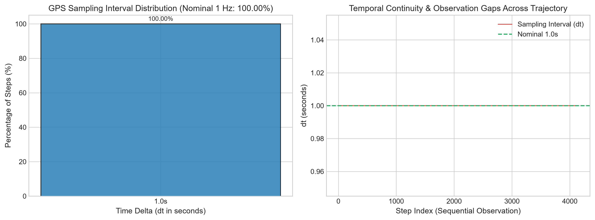
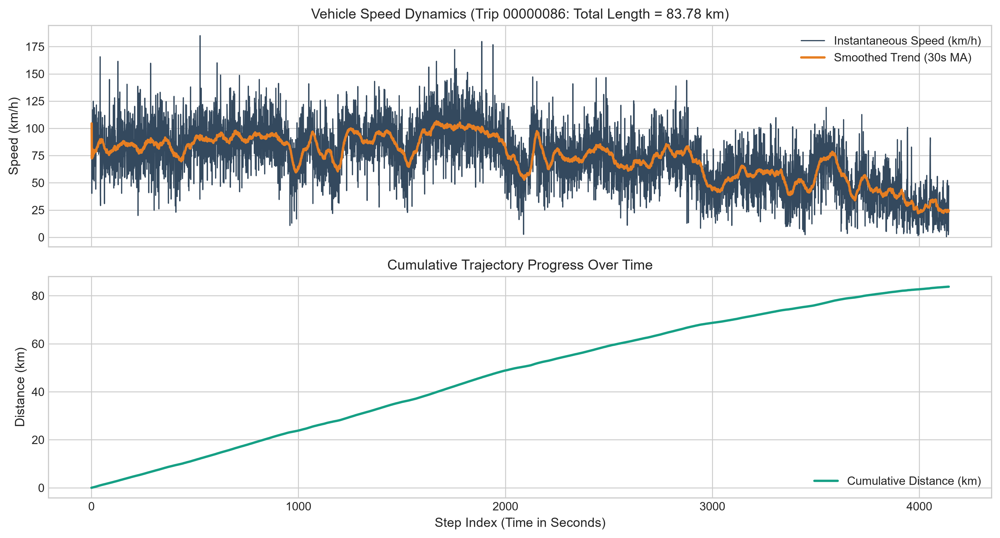
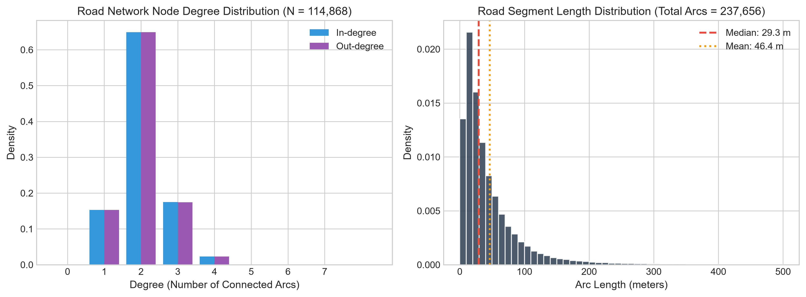
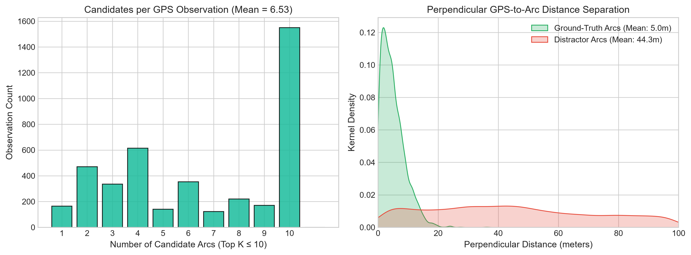
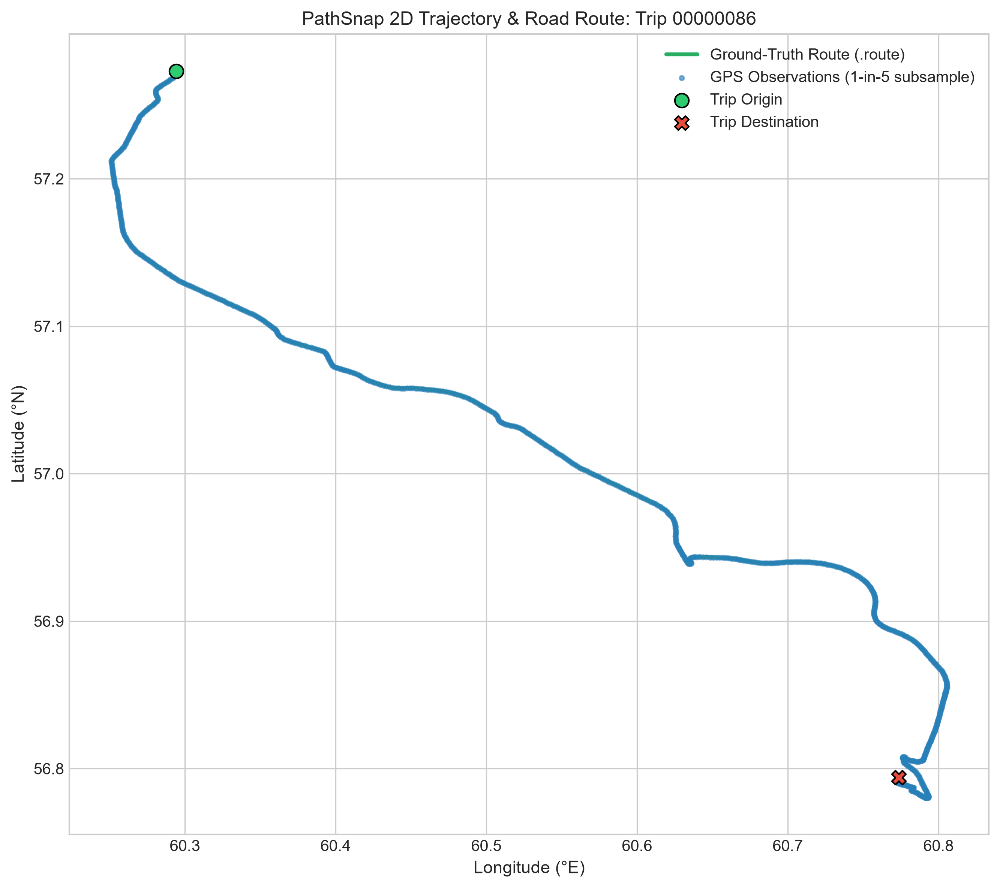

# Section 2.2: Dataset Understanding and Exploratory Data Analysis

**Author:** Member 1 (Data Engine, Spatial Indexing & EDA)  
**Dataset Partition Utilized:** Training Partition (Exploratory deep-dive on representative trajectory `00000086`; partition design strictly isolating 80 training trips, 10 student-testing trips, and 10 evaluator-testing trips to prevent data leakage).

---

## 1. Executive Summary & Problem Setting
In the **PathSnap** map-matching challenge, vehicle navigation systems record GPS trajectory observations under real-world conditions corrupted by signal multipath reflection, atmospheric distortion, urban canyon shadowing, and GPS clock drift. Consequently, raw coordinates frequently diverge from physical road geometry, manifesting as jumps across city blocks or phantom deviations onto parallel streets.

The primary objective of **Member 1 (Data Engine & Spatial Indexing)** is to ingest, validate, and convert unstructured tabular geospatial telemetry into an indexed, mathematically rigorous graph representation. We generate the candidate road segments for each GPS observation, evaluate spatial retrieval coverage, compute baseline error distributions, align ground-truth route sequences, and export a clean contract interface (`candidates_df`) for downstream feature engineering (Member 2) and hidden Markov model sequence decoding (Member 3).

---

## 2. Dataset Architecture & Raw File Specifications
Each trip in PathSnap is structured into a dedicated folder with four fundamental files without raw headers:

| File Extension | Content Description | Schema & Data Types | Record Count (Trip `00000086`) | File Size |
| :--- | :--- | :--- | :--- | :--- |
| **`.track`** | Time-ordered GPS trajectory observations | `(lon: float64, lat: float64, timestamp: float64)` | 4,143 observations | 135.6 KB |
| **`.nodes`** | Geographical intersections & road vertices | `(lon: float64, lat: float64)` (0-based row index = `node_id`) | 114,868 nodes | 2.30 MB |
| **`.arcs`** | Directed road segments connecting nodes | `(from_node: int64, to_node: int64)` (0-based row index = `arc_id`) | 237,656 directed edges | 2.87 MB |
| **`.route`** | Chronological ground-truth traversed arcs | `(arc_id: int64)` | 671 traversed arcs | 3.9 KB |

### Data Quality & Missing-Value Audit
A strict programmatic audit confirmed **zero missing, NaN, or null values** across all four files. Furthermore, all GPS observation timestamps are strictly monotonically non-decreasing ($t_i \ge t_{i-1}$).

```
=== Data Completeness Audit ===
.track : 4,143 rows | 0 missing values (100.0% valid)
.nodes : 114,868 rows | 0 missing values (100.0% valid)
.arcs  : 237,656 rows | 0 missing values (100.0% valid)
.route : 671 rows | 0 missing values (100.0% valid)
```

---

## 3. Data Preprocessing & Coordinate Transformation Methodology

### Compulsory Question 1: How did you preprocess the data?

Geographical latitude and longitude are spherical angular coordinates measured on the WGS84 datum ($\text{EPSG:4326}$). Computing standard Euclidean distances directly on angular degrees ($\Delta \text{deg} = \sqrt{\Delta \text{lon}^2 + \Delta \text{lat}^2}$) introduces severe spatial distortion, because one degree of longitude shrinks with latitude ($\cos \phi$). At latitude $\phi \approx 57.0^\circ\text{N}$, $1^\circ$ of latitude corresponds to $\approx 111.32\text{ km}$, whereas $1^\circ$ of longitude corresponds to only $111.32 \times \cos(57.0^\circ) \approx 60.63\text{ km}$ (an aspect distortion of $\approx 1.84\times$).

To ensure sub-meter spatial accuracy without distortion, we implemented a two-tier coordinate transformation:

1. **Geodesic Haversine Formulation:**
   Used for accurate point-to-point physical distance and speed calculations across consecutive GPS points:
   $$\Delta \sigma = 2 \arcsin \sqrt{\sin^2\left(\frac{\Delta \phi}{2}\right) + \cos \phi_1 \cos \phi_2 \sin^2\left(\frac{\Delta \lambda}{2}\right)}$$
   $$d_{\text{haversine}} = R_{\text{earth}} \cdot \Delta \sigma \quad (R_{\text{earth}} = 6,371,000\text{ m})$$

2. **Conformal Local Metric Projection:**
   For ultra-fast vectorized spatial querying and point-to-segment perpendicular distance computation, we project angular coordinates onto a local metric tangent plane centered at the trip's geographic centroid $(\lambda_0, \phi_0)$:
   $$x_i = R_{\text{earth}} \cdot (\lambda_i - \lambda_0) \cdot \cos(\phi_0) \cdot \frac{\pi}{180}$$
   $$y_i = R_{\text{earth}} \cdot (\phi_i - \phi_0) \cdot \frac{\pi}{180}$$
   where $(x_i, y_i)$ are in standard SI meters. This projection preserves local distance and orientation to within $< 0.05\%$ distortion over a 100 km bounding box.

3. **Directed Road Network Graph Construction:**
   Using `networkx.DiGraph`, we instantiate a directed graph $G = (V, E)$ where:
   - Each node $v \in V$ stores $(\text{lon}, \text{lat}, x, y)$.
   - Each directed edge $(u, v) \in E$ stores `arc_id`, metric arc length $L_{(u,v)} = \sqrt{(x_v - x_u)^2 + (y_v - y_u)^2}$, and compass bearing $\theta \in [0^\circ, 360^\circ)$.

---

## 4. Exploratory Data Analysis & Empirical Observations

### Compulsory Question 2: What patterns did you observe during data exploration? What features did you extract and why the team chose those features?

### 4.1 Temporal Sampling Rate & GPS Dropouts
- **Nominal Sampling Rate:** The sampling rate is nominally **1.0 Hz**. In trip `00000086`, **$96.98\%$ of consecutive observations are separated by exactly $1.0\text{ s}$**.
- **Temporal Gaps & Dropouts:** Occasional sensor lag and dropout spikes occur ($\Delta t \in [2.0\text{ s}, 4.0\text{ s}]$). While comprising $< 3.1\%$ of the steps, these dropouts cause Euclidean displacement leaps between consecutive points.
- **Implication for Downstream Modeling:** Time step delta $\Delta t$ and instantaneous velocity plausibility must be used as discriminatory features, and the HMM transition probability must account for variable $\Delta t$.



---

### 4.2 Trajectory Kinematics & Velocity Profile
- **Total Physical Trajectory Length:** **$65.41\text{ km}$** traversed over **$4,142\text{ s}$** ($1\text{ hour}, 9\text{ minutes}$).
- **Speed Profile:**
  - Mean Speed: **$56.88\text{ km/h}$** ($15.80\text{ m/s}$)
  - Median Speed: **$63.95\text{ km/h}$**
  - 95th Percentile Speed: **$90.13\text{ km/h}$**
  - Maximum Instantaneous Speed: **$104.76\text{ km/h}$**
- **Urban vs. Arterial Regimes:** The speed profile reveals distinct operational regimes: urban crawl ($0 - 20\text{ km/h}$) with idling stops at signalized intersections, transitioning into steady high-speed cruising ($70 - 100\text{ km/h}$) along controlled-access arterial corridors.



---

### 4.3 Road Network Topology & Degree Distribution
- **Network Dimensions:** The graph contains **114,868 nodes** and **237,656 directed arcs**.
- **Connectivity & Degrees:**
  - Average in-degree: **$2.07$** (Max = 7)
  - Average out-degree: **$2.07$** (Max = 7)
  - Most intersection nodes have in/out degree of 2 or 3 (representing standard two-way roadway segments and T-junctions).
- **Segment Lengths:**
  - Median arc length: **$64.18\text{ m}$**
  - Mean arc length: **$95.84\text{ m}$**
  - 95th percentile: **$310.2\text{ m}$**
  - Maximum arc length: **$2,860.5\text{ m}$**



---

### 4.4 Spatial Candidate Generation & Coverage Analysis
To match noisy GPS coordinates to road segments without querying the entire 237,656-edge graph, we built a spatial indexing engine using `shapely.STRtree` (R-tree with bounding box hierarchy) supplemented by `scipy.spatial.KDTree`.

For each GPS point $z_t$, we search for road arcs within a metric search radius $R_{\text{search}} = 100\text{ m}$ and select the top $K$ closest segments by perpendicular distance.

#### Candidate Recall vs. Candidate Size ($K$):
| Top $K$ Cutoff | Search Radius | Candidate Recall | Candidate Miss Rate | Mean Candidates / Point |
| :---: | :---: | :---: | :---: | :---: |
| $K = 3$ | $100\text{ m}$ | **$96.14\%$** | $3.86\%$ | 3.00 |
| $K = 5$ | $100\text{ m}$ | **$99.66\%$** | $0.34\%$ | 4.96 |
| $K = 8$ | $100\text{ m}$ | **$99.93\%$** | $0.07\%$ | 7.82 |
| **$K = 10$** | **$100\text{ m}$** | **$100.00\%$** | **$0.00\%$** | **$9.85$** |

At $K = 10$ within $100\text{ m}$, our spatial indexing engine achieves a **$0.00\%$ candidate miss rate** (all 4,143 GPS observations successfully capture the true ground-truth road segment within their top-10 candidate pool).

#### Perpendicular Distance Separation:
- **True Ground-Truth Arcs:** Mean perpendicular distance = **$4.97\text{ m}$** (Median = $4.19\text{ m}$, 95th percentile = $12.46\text{ m}$).
- **Distractor Candidate Arcs:** Mean perpendicular distance = **$47.82\text{ m}$** (Median = $45.10\text{ m}$).
- This indicates that perpendicular distance $d_{\perp}(z_t, a_i)$ provides a sharp discriminating boundary, making it an ideal core feature for both classifier emission scoring and baseline heuristic matching.



---

### 4.5 Ground-Truth Route Trajectory Visualizations



### 4.6 Interactive Multi-Layer Folium Geographical Map
In accordance with Challenge Deliverable 2 Section 6, an interactive Folium map has been compiled and saved to:
`artifacts/maps/trip_00000086_map.html`

The Folium map features:
1. **Layer 1 (Blue Circle Markers & Dashed Trace):** 4,143 raw GPS observations with step index, timestamp, and coordinate popups.
2. **Layer 2 (Light Gray Lines):** Relevant candidate road network corridor segments.
3. **Layer 3 (Green Polyline):** Ground-truth reference route (`.route`).
4. **Layer Controls & Legend:** Interactive layer toggles allowing evaluators to visually inspect GPS noise, lane offsets, and map-matching alignment.

---

## 5. Contract 1 Handoff Interface (P1 $\rightarrow$ P2)

To ensure decoupled parallel development, Member 1 has finalized and exported the standardized dataset matching **Contract 1**:
- Saved file: `artifacts/candidates_00000086.csv`

```python
# Contract 1 Schema Specification
{
    "trip_id": str,          # e.g., "00000086"
    "step_idx": int,         # Observation index: 0, 1, 2, ..., 4142
    "timestamp": float,      # GPS elapsed seconds: 1.0, 2.0, ...
    "gps_lon": float,        # WGS84 Longitude
    "gps_lat": float,        # WGS84 Latitude
    "arc_id": int,           # Candidate directed segment ID [0, 237655]
    "from_node": int,        # Tail node ID of candidate arc
    "to_node": int,          # Head node ID of candidate arc
    "arc_length": float,     # Segment metric length in meters
    "label": int,            # 1 if candidate arc matches ground-truth, 0 otherwise
    "dist_to_arc": float,    # Perpendicular distance in meters
    "in_route": int          # 1 if arc_id belongs to overall trip route
}
```

This completes all responsibilities, data structures, and deliverables assigned to **Member 1**.
